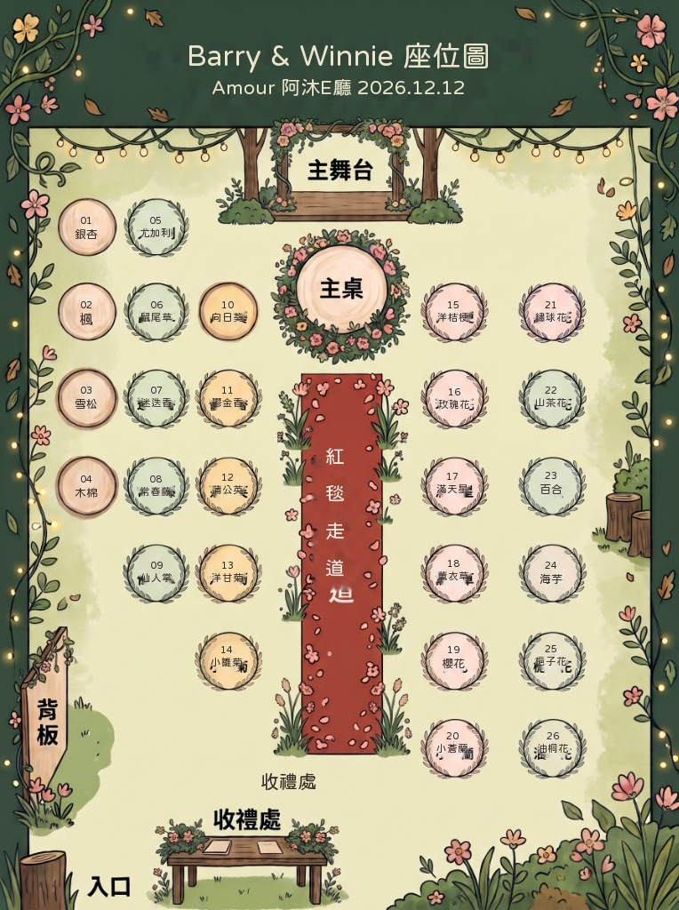
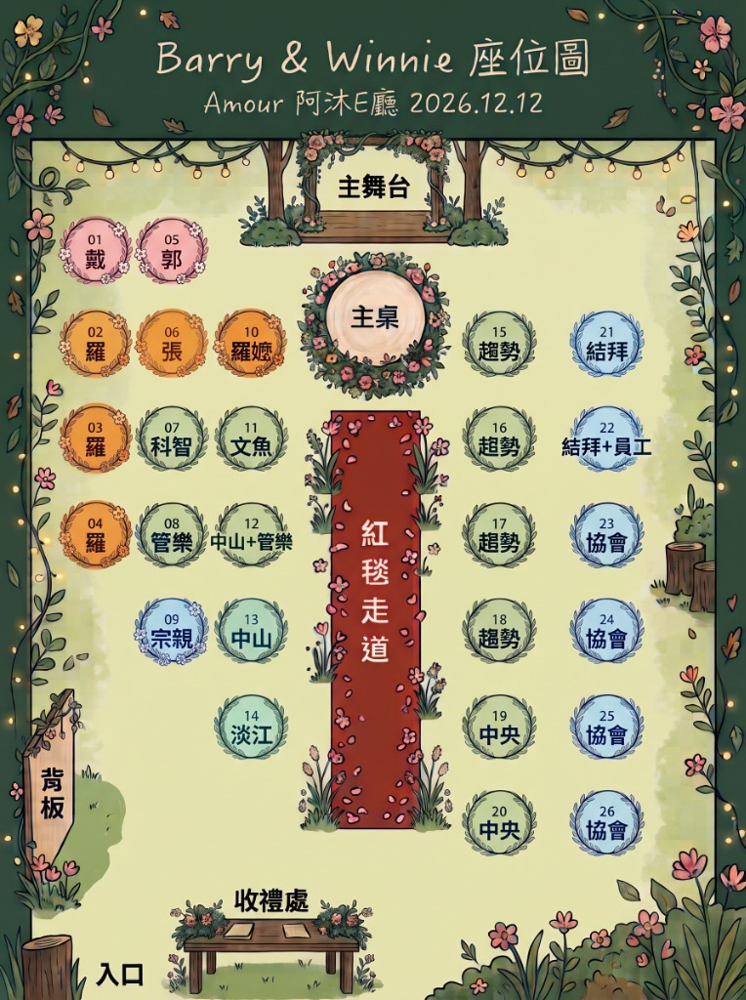

# 🌿 Barry & Winnie 婚禮｜Amour 阿沐 E廳 26客桌（總桌數27桌）雙版本座位圖規劃書（終極定案版）

> **活動資訊**
> - **新人**：Barry（羅聖明）♥ Winnie（戴婉錡）
> - **日期**：2026 年 12 月 12 日（星期六）午宴
> - **宴會廳**：Amour 阿沐 水漾森林 E 廳（中壢）
> - **定案桌數**：**1 主桌 ＋ 26 客桌（共 27 實桌，預估出席總人數 256 位＋主桌 11 位）**
> - **線上 Google 試算表**：[1212 結婚盛宴 賓客對照表（即時連動母檔）](https://docs.google.com/spreadsheets/d/1ZRQiqfzctmH7RrxwF75vulaNOXhzmxL4k0WwNPgBnaw/edit?gid=1862686764#gid=1862686764)

---

## 🎨 雙版本手繪座位圖對照

全場規劃「**植栽花卉版**」與「**親友群組稱謂版**」雙版本，滿足不同使用場景：
* **🌿 版本 A（植栽花卉名版）**：用於現場迎賓大背板、宴會桌卡、童話森林主題視覺，唯美浪漫高雅。
* **🏷️ 版本 B（親友群組稱謂版・校正定案版）**：用於總招待、現場接待人員帶位、雙方父母現場核對，四大色彩分區，一眼辨識親友團體、帶位零失誤！

````carousel

<!-- slide -->

````

---

## 🎨 四大色彩分區與全場方位鳥瞰圖

手繪稱謂圖以四種唯美色彩精準區分四大賓客族群：
* 🌸 **粉色花圈（女方親戚 2 桌）**：`01 戴`（戴家親戚）、`05 郭`（郭家親戚）。
* 🍊 **橘色花圈（男方親戚 5 桌）**：`02 羅`、`03 羅`、`04 羅`、`06 張`、`10 羅嬤`。
* 🌿 **綠色花圈（新人超好朋友 12 桌・紅毯兩側對稱包攬）**：
  * 紅毯左側（6 桌）：`07 科智`、`08 管樂`、`11 文魚`、`12 中山+管樂`、`13 中山`、`14 淡江`
  * 紅毯右側（6 桌）：`15 趨勢`、`16 趨勢`、`17 趨勢`、`18 趨勢`、`19 中央`、`20 中央`
* 🔷 **藍色花圈（男方長輩朋友／協會／結拜／宗親 7 桌）**：`09 宗親`、`21 結拜`、`22 結拜+員工`、`23 協會`、`24 協會`、`25 協會`、`26 協會`。

```
                                      【 主 舞 台 】
                                            │
                                      [ 👑 主 桌 ]
                               (雙方父母及新人至親 11人席)
                                            │
    第 1 列 (戴家/羅家長輩)   第 2 列 (郭家/張家/長輩友)   [紅毯]   第 4 列 (趨勢科技/中央同窗) 第 5 列 (爸爸結拜/協會長友)
    01 銀杏 ｜ 01 戴 (🌸粉)   05 尤加利 ｜ 05 郭 (🌸粉)   走道    15 洋桔梗 ｜ 15 趨勢 (🌿綠) 21 繡球花 ｜ 21 結拜 (🔷藍)
    02 楓   ｜ 02 羅 (🍊橘)   06 鼠尾草 ｜ 06 張 (🍊橘)   走道    16 玫瑰花 ｜ 16 趨勢 (🌿綠) 22 山茶花 ｜ 22 結拜+員工(🔷藍)
    03 雪松 ｜ 03 羅 (🍊橘)   07 迷迭香 ｜ 07 科智 (🌿綠) 走道    17 滿天星 ｜ 17 趨勢 (🌿綠) 23 百合   ｜ 23 協會 (🔷藍)
    04 木棉 ｜ 04 羅 (🍊橘)   08 常春藤 ｜ 08 管樂 (🌿綠) 走道    18 薰衣草 ｜ 18 趨勢 (🌿綠) 24 海芋   ｜ 24 協會 (🔷藍)
    (新秘通道/側邊緩衝)       09 仙人掌 ｜ 09 宗親 (🔷藍) 走道    19 櫻花   ｜ 19 中央 (🌿綠) 25 梔子花 ｜ 25 協會 (🔷藍)
    (4×4m 森林拍照背板)      ──────────────────── 走道    20 小蒼蘭 ｜ 20 中央 (🌿綠) 26 油桐花 ｜ 26 協會 (🔷藍)
                              第 3 列 (新人摯友・紅毯走道) 走道
                              10 向日葵 ｜ 10 羅嬤 (🍊橘)
                              11 鬱金香 ｜ 11 文魚 (🌿綠)
                              12 蒲公英 ｜ 12 中山+管樂(🌿綠)
                              13 洋甘菊 ｜ 13 中山 (🌿綠)
                              14 小雛菊 ｜ 14 淡江 (🌿綠)
                                            │
                                       【 入 口 】
                                            │
                                      【 收禮處 】
```

---

## 🌸 全場 27 桌雙版本對照與線上母檔即時數據清單

| 桌號 | 🌿 浪漫花卉名 (版A) | 🏷️ 群組稱謂簡稱 (版B) | 視覺色彩 | 📝 賓客群組詳細說明（線上母檔備註） | 空間位置 | 目前人數 | 素食 | 兒童椅 |
| :---: | :---: | :---: | :---: | :--- | :--- | :---: | :---: | :---: |
| **👑 主桌** | **主桌** | **主桌** | 暖木金 | 雙方父母及新人至親（尊爵主桌） | 舞台正前方中央花圈 | **11** | 1 | 0 |
| **01** | **銀杏** | **戴** | 🌸 粉色 | 女方親戚長輩（戴家親戚） | 第 1 列第 1 排（舞台左前至尊席） | **7** | 0 | 0 |
| **02** | **楓** | **羅** | 🍊 橘色 | 羅家阿嬤親戚 | 第 1 列第 2 排 | **10** | 0 | 0 |
| **03** | **雪松** | **羅** | 🍊 橘色 | 羅家長輩親戚 | 第 1 列第 3 排 | **10** | 0 | 0 |
| **04** | **木棉** | **羅** | 🍊 橘色 | 羅家長輩親戚 | 第 1 列第 4 排（新秘通道旁） | **10** | 0 | 0 |
| **05** | **尤加利** | **郭** | 🌸 粉色 | 女方親戚（郭家親戚） | 第 2 列第 1 排 | **7** | 0 | 0 |
| **06** | **鼠尾草** | **張** | 🍊 橘色 | 男方親戚（張家親戚） | 第 2 列第 2 排 | **11** | 0 | 1 |
| **07** | **迷迭香** | **科智** | 🌿 綠色 | 科智所（學長姐與同學好友） | 第 2 列第 3 排（舒適敘舊區） | **9** | 0 | 0 |
| **08** | **常春藤** | **管樂** | 🌿 綠色 | 平鎮高中管樂團好友 | 第 2 列第 4 排 | **9** | 1 | 0 |
| **09** | **仙人掌** | **宗親** | 🔷 藍色 | 羅氏宗親長輩親友 | 第 2 列第 5 排（走道旁外側席） | **10** | 0 | 0 |
| **10** | **向日葵** | **羅嬤** | 🍊 橘色 | 羅家親戚（奶奶好友長輩） | 第 3 列第 1 排（紅毯左側走道首排） | **10** | 0 | 0 |
| **11** | **鬱金香** | **文魚** | 🌿 綠色 | 千禧龍＋小鮮奶（新娘閨蜜死黨好友） | 第 3 列第 2 排（紅毯左側走道） | **9** | 0 | 0 |
| **12** | **蒲公英** | **中山+管樂** | 🌿 綠色 | 中山大學 ＋ 平鎮管樂跨界好友 | 第 3 列第 3 排（紅毯左側走道） | **10** | 0 | 1 |
| **13** | **洋甘菊** | **中山** | 🌿 綠色 | 中山大學同窗好友 | 第 3 列第 4 排（紅毯左側走道） | **7** | 0 | 0 |
| **14** | **小雛菊** | **淡江** | 🌿 綠色 | 淡江大學同窗死黨（核心伴郎桌） | 第 3 列第 5 排（紅毯左側走道） | **11** | 0 | 1 |
| **15** | **洋桔梗** | **趨勢** | 🌿 綠色 | 趨勢科技－溫馨群同事好友 | 第 4 列第 1 排（紅毯右側走道首排） | **10** | 0 | 0 |
| **16** | **玫瑰花** | **趨勢** | 🌿 綠色 | 銘婉再輝佳 ＋ VR 摯友（核心伴娘桌） | 第 4 列第 2 排（紅毯右側走道） | **10** | 0 | 0 |
| **17** | **滿天星** | **趨勢** | 🌿 綠色 | 趨勢科技－22屆福委夥伴 | 第 4 列第 3 排（紅毯右側走道） | **10** | 0 | 1 |
| **18** | **薰衣草** | **趨勢** | 🌿 綠色 | 趨勢科技－Support 團隊夥伴 | 第 4 列第 4 排（紅毯右側走道） | **11** | 0 | 1 |
| **19** | **櫻花** | **中央** | 🌿 綠色 | 中央大學資管好友 | 第 4 列第 5 排（紅毯右側走道） | **8** | 0 | 0 |
| **20** | **小蒼蘭** | **中央** | 🌿 綠色 | 中央大學資管好友 | 第 4 列第 6 排（紅毯右側走道末排） | **8** | 1 | 0 |
| **21** | **繡球花** | **結拜** | 🔷 藍色 | 男方爸爸結拜兄弟長輩桌 | 第 5 列第 1 排（舞台右前至尊席） | **9** | 0 | 0 |
| **22** | **山茶花** | **結拜+員工** | 🔷 藍色 | 男方爸爸員工／結拜長輩席 | 第 5 列第 2 排（舞台右前第 2 排） | **9** | 3 | 0 |
| **23** | **百合** | **協會** | 🔷 藍色 | 男方爸爸協會長輩席 1 | 第 5 列第 3 排（安靜舒適區） | **10** | 0 | 0 |
| **24** | **海芋** | **協會** | 🔷 藍色 | 男方爸爸協會長輩席 2 | 第 5 列第 4 排（安靜舒適區） | **10** | 0 | 0 |
| **25** | **梔子花** | **協會** | 🔷 藍色 | 男方爸爸協會長輩席 3 | 第 5 列第 5 排（安靜舒適區） | **10** | 0 | 0 |
| **26** | **油桐花** | **協會** | 🔷 藍色 | 男方爸爸協會長輩席 4 | 第 5 列第 6 排（安靜舒適區） | **10** | 0 | 0 |
| **合計** | **全場 27 實桌** | **雙版本對應** | — | **總出席人數 256 位（含主桌 11 人）** | **阿沐 E 廳水漾森林** | **256** | **6** | **5** |

---

### 💡 現場招待作業小錦囊（接待帶位專用）

1. **依顏色與團體精準帶位**：
   * 🌸 **粉色（新娘親戚長輩）**：直接帶至 `01 戴`（戴家長輩）或 `05 郭`（郭家親戚）。
   * 🍊 **橘色（新郎親戚長輩）**：直接帶至舞台左側 `02~04 羅`、`06 張`、`10 羅嬤`。
   * 🌿 **綠色（新人超好朋友 12 桌・紅毯兩側）**：
     * 左側（6 桌）：`07 科智`、`08 管樂`、`11 文魚`、`12 中山+管樂`、`13 中山`、`14 淡江`
     * 右側（6 桌）：`15~18 趨勢`（溫馨群/VR伴娘/福委/Support）、`19~20 中央`
   * 🔷 **藍色（男方長輩朋友／協會／結拜）**：
     * 宗親長友：`09 宗親`
     * 爸爸結拜與員工：`21 結拜`、`22 結拜+員工`
     * 爸爸協會好友：`23~26 協會`（共 4 桌）
2. **特殊飲食與育兒需求**：
   * **素食 6 位**：主桌 (1)、08 常春藤/管樂 (1)、20 小蒼蘭/中央 (1)、22 山茶花/結拜員工 (3 位全素，出菜特別注意)。
   * **兒童椅 5 張**：06 鼠尾草/張 (1)、12 蒲公英/中山管樂 (1)、14 小雛菊/淡江 (1)、17 滿天星/趨勢福委 (1)、18 薰衣草/趨勢Support (1)。
